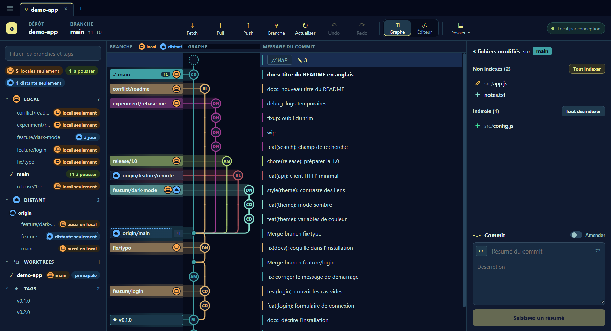
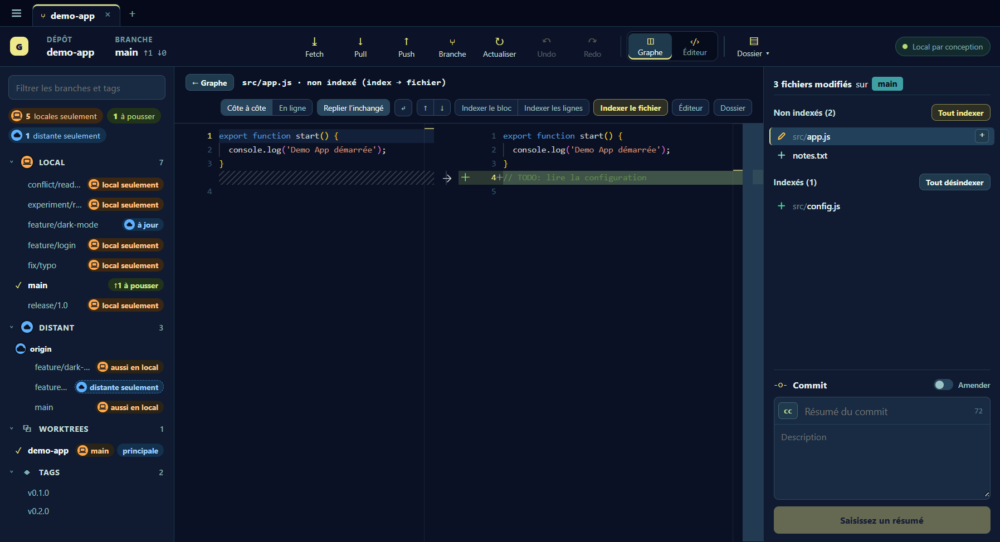
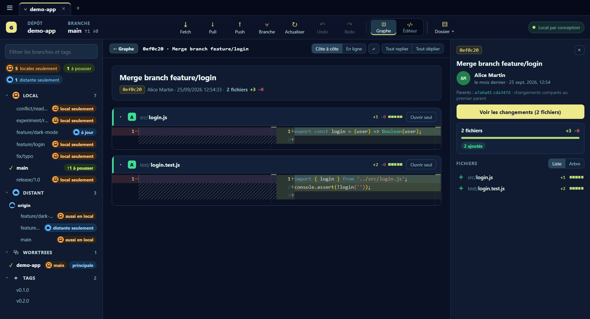
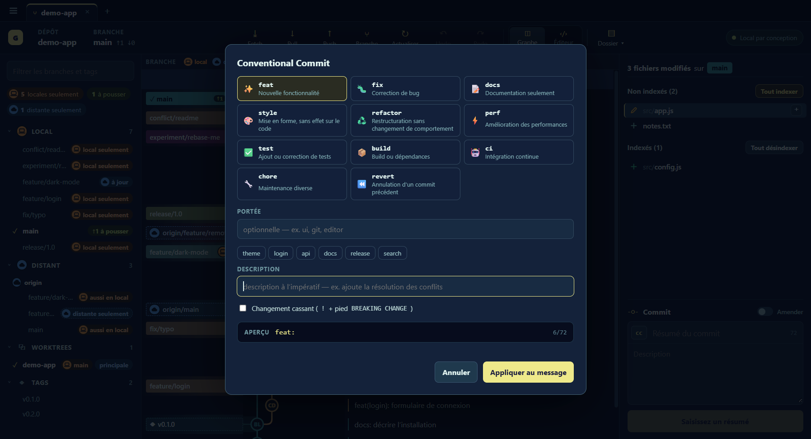
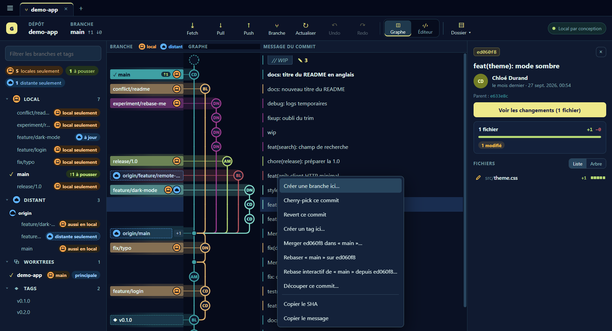
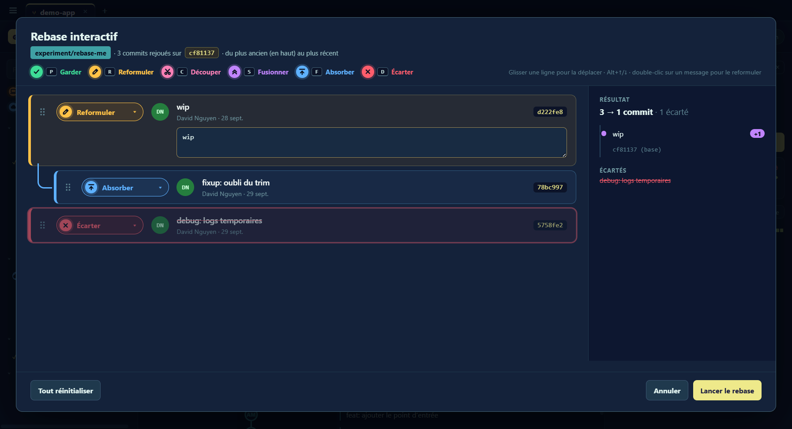
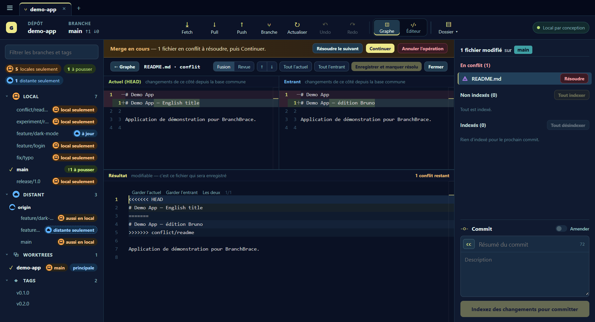
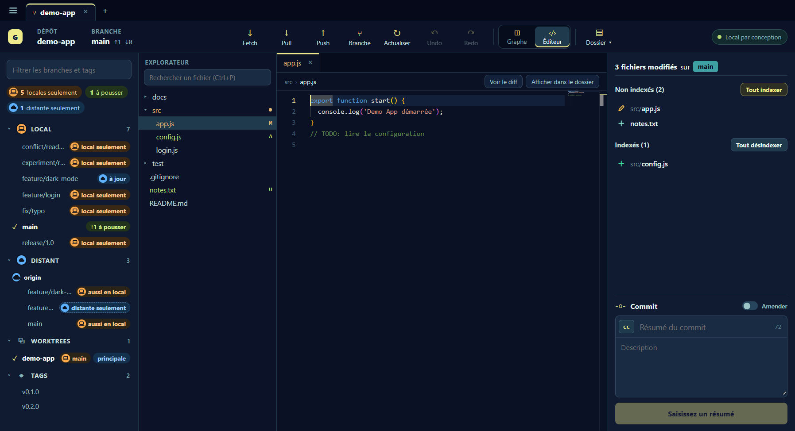

# BranchBrace

[](https://github.com/BranchBrace/branchbrace/releases/latest)
[](LICENSE)
[](https://buymeacoffee.com/monnierant)

Un client Git de bureau, local et sans télémétrie. BranchBrace affiche le graphe de vos branches, vous laisse indexer ligne par ligne, réécrire l'historique et résoudre les conflits, et garde à chaque opération risquée un point de récupération pour revenir en arrière.



- **Local par conception.** Pas de compte, pas de service hébergé, pas de télémétrie. Rien ne quitte votre machine sans un push, un fetch, un pull ou un clone.
- **Réversible d'abord.** Avant un rebase, un reset, un merge ou une suppression, BranchBrace enregistre un point de récupération (modifications non commitées comprises). Undo et Redo le restaurent.
- **Git CLI sous le capot.** Vos hooks, vos credential helpers et votre configuration SSH sont utilisés tels quels.

## Sommaire

- [Fonctionnalités](#fonctionnalités)
- [Installation](#installation)
- [Premiers pas](#premiers-pas)
- [Confidentialité et sécurité](#confidentialité-et-sécurité)
- [Développement](#développement)
- [Contribuer](#contribuer)
- [Licence](#licence)

## Fonctionnalités

### Graphe et branches

Le graphe montre l'historique de toutes les branches, avec l'auteur de chaque commit. Le panneau de gauche range les branches en locales, distantes, worktrees et tags, et indique pour chacune si elle est à jour, en avance, en retard, locale seulement ou distante seulement. Un double-clic sur une branche fait le checkout ; une branche distante seulement devient une branche locale de suivi.

Plusieurs dépôts s'ouvrent en onglets, et la session est restaurée au démarrage. Le fetch tourne en arrière-plan toutes les 5 minutes par défaut (réglable ou désactivable) et ne touche qu'aux branches distantes ; le pull reste un clic.

### Indexer ligne par ligne

Cliquez sur un fichier modifié pour ouvrir son diff (côte à côte ou en ligne). Vous indexez le fichier entier, le bloc sous le curseur ou seulement les lignes sélectionnées. Après chaque indexation partielle, BranchBrace relit l'index et le restaure s'il ne correspond pas exactement à votre choix. La copie de travail se modifie directement depuis le diff.



### Revue de commit

« Voir les changements » affiche tous les fichiers d'un commit l'un sous l'autre, chacun repliable.



### Commits conventionnels

Le bouton `cc` du composeur ouvre un assistant [Conventional Commits](https://www.conventionalcommits.org/) : type, portée (avec les portées déjà utilisées dans le dépôt), description et changement cassant, avec un aperçu du message final. Le composeur sait aussi amender le dernier commit.



### Actions sur les commits

Un clic droit sur un commit propose : créer une branche ou un tag, cherry-pick, revert, merge, rebase, rebase interactif, découper le commit, copier le SHA ou le message. Le clic droit sur une branche ajoute checkout, merge, rebase, pull, push et push forcé ; ce dernier passe toujours par `--force-with-lease` et sa confirmation liste les commits distants qui seraient perdus.



### Rebase interactif

Chaque commit reçoit une action : garder, reformuler, découper, fusionner, absorber ou écarter, au clic ou au clavier (P, R, C, S, F, D). Les lignes se réordonnent par glisser-déposer ou avec Alt+↑/↓. La colonne de droite montre l'historique qui en résultera avant que vous lanciez le rebase.



### Résolution de conflits

Pendant un merge, un rebase ou un cherry-pick en conflit, un bandeau indique l'opération en cours et propose de continuer ou d'annuler. L'outil de fusion montre la version actuelle, la version entrante et le résultat modifiable ; chaque conflit se règle en gardant un côté, l'autre ou les deux.



### Éditeur intégré

Le mode Éditeur ouvre les fichiers du dépôt dans Monaco, avec un explorateur qui marque les fichiers modifiés (M), ajoutés (A) et non suivis (U), et une recherche rapide (Ctrl+P). La coloration syntaxique s'étend avec les grammaires TextMate des extensions VS Code déjà installées ou importées en `.vsix` (menu ☰ › « Extensions VS Code… »), lues localement sans téléchargement.



### Et aussi

- Branches : créer depuis n'importe quel commit, renommer (l'upstream suit), basculer sans perdre les modifications en cours.
- Tags : créer sur un commit, pousser un tag précis vers un dépôt distant, jamais avec `--tags`.
- Worktrees : lister, créer pour une branche, ouvrir en onglet, supprimer.
- Dépôts distants : ajouter ou modifier ; la page d'une branche sur GitHub ou GitLab s'ouvre en un clic.
- Mises à jour : menu ☰ › « Mises à jour… », canal Stable ou Bêta (voir [plus bas](#mises-à-jour)).

## Installation

BranchBrace a besoin de [Git](https://git-scm.com/downloads) installé et accessible dans le `PATH`.

### Windows

1. Téléchargez `BranchBrace.Setup.<version>.exe` depuis la [dernière release](https://github.com/BranchBrace/branchbrace/releases/latest).
2. Vérifiez si vous le souhaitez son empreinte avec le fichier `.sha256` publié à côté :

   ```powershell
   Get-FileHash .\BranchBrace.Setup.*.exe -Algorithm SHA256
   ```

3. Lancez l'installateur. Il s'installe pour l'utilisateur courant, sans droits administrateur, et vous laisse choisir le dossier.

### Linux et macOS

Aucun paquet n'est encore publié pour ces systèmes. Vous pouvez construire l'application vous-même (voir [Développement](#développement)) : `npm run package:linux` produit un paquet `.deb` pour Linux x64.

Les plateformes effectivement testées sont listées dans [`docs/VERIFICATION.md`](docs/VERIFICATION.md).

### Mises à jour

Menu ☰ › « Mises à jour… ». Le canal **Stable** suit les versions publiées depuis `main`, le canal **Bêta** y ajoute les préversions RC publiées depuis `rc`. La recherche n'interroge que l'API publique des releases GitHub, sur demande ou au démarrage si l'option est cochée (désactivée par défaut). Sous Windows, l'installateur est téléchargé, vérifié par SHA-256 puis lancé ; ailleurs, la page de la release s'ouvre. Détails dans l'[ADR 0005](docs/adr/0005-mises-a-jour.md).

## Premiers pas

1. Ouvrez un dépôt : menu ☰ › « Ouvrir un dépôt… » (Ctrl+O), ou le bouton **+** de la barre d'onglets.
2. Sélectionnez la ligne `// WIP` du graphe pour voir vos changements en cours, indexez-les, écrivez un résumé et committez.
3. Clic droit sur un commit ou une branche pour les autres actions.

Pour essayer sans risque, créez un dépôt de démonstration (plusieurs auteurs, merges, branches distantes, une branche à rebaser, une branche en conflit) :

```bash
node scripts/create-sandbox.mjs ~/branchbrace-sandbox
```

Les captures de ce README ont été prises sur ce dépôt.

## Confidentialité et sécurité

- Aucune télémétrie, aucun compte. L'inspection, l'historique, les diffs, l'indexation et les commits fonctionnent hors ligne.
- Le contenu du dépôt ne sort que par une action réseau explicite (push, fetch, pull, clone) ou par le fetch automatique, qui ne fait que lire les dépôts distants.
- Les identifiants restent gérés par Git (Git Credential Manager, credential helpers, SSH). Les URL de dépôts distants qui contiennent un identifiant sont refusées.
- Un push n'est annoncé réussi qu'après vérification de la référence distante. Un push rejeté n'est jamais retenté en force.
- Les décisions de conception sont dans [`docs/adr/`](docs/adr/), en particulier la doctrine « réversible d'abord » ([ADR 0006](docs/adr/0006-reversible-d-abord.md)).

## Développement

Prérequis : Node.js 22 ou plus récent, npm et Git.

```bash
git clone https://github.com/BranchBrace/branchbrace.git
cd branchbrace
npm ci
npm run dev
```

| Script | Rôle |
| --- | --- |
| `npm run dev` | Vite et Electron en mode développement |
| `npm run lint` | Lint des sources |
| `npm run typecheck` | Vérification des invariants du projet |
| `npm test` | Build Vite puis tests d'intégration sur des dépôts Git temporaires |
| `npm run build` | Application non empaquetée dans `artifacts/` |
| `npm run package:win` | Installateur Windows (NSIS) |
| `npm run package:linux` | Paquet `.deb` Linux x64 |

L'interface est en JavaScript sans framework (`src/`), le processus principal Electron dans `electron/`. Tous les appels Git passent par `src/git.js`. La spécification fonctionnelle est dans [`docs/MVP.md`](docs/MVP.md) et le vocabulaire du domaine dans [`CONTEXT.md`](CONTEXT.md).

## Contribuer

Les issues et les pull requests sont bienvenues.

- Une branche par changement, PR vers `rc`. `main` porte les versions stables, `rc` les préversions.
- Messages de commit au format [Conventional Commits](https://www.conventionalcommits.org/) : ils pilotent [semantic-release](https://semantic-release.gitbook.io/) (`feat` donne une version mineure, `fix` un correctif, `!` une version majeure).
- La CI lance lint, typecheck, tests, build et Semgrep ; elle doit être verte avant le merge.

## Licence

BranchBrace est distribué sous [licence MIT](LICENSE). Les composants tiers embarqués et leurs licences sont listés dans [`THIRD_PARTY_NOTICES.md`](THIRD_PARTY_NOTICES.md).

BranchBrace n'est pas affilié à GitKraken et n'en reprend ni code, ni marque, ni texte, ni ressource graphique.
